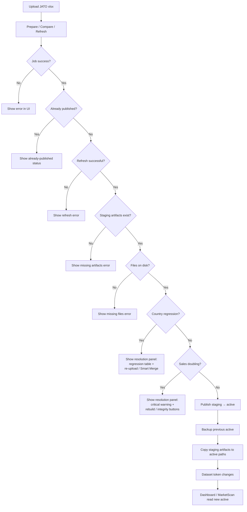

# JATO Monthly Update Data Lifecycle Runbook

Date: 2026-05-17
Scope: JATO monthly Excel upload, active Parquet publication, MarketScan/Dashboard data correctness, and deploy/runtime boundaries.

## Executive Rule

JATO monthly data is runtime data, not code deploy payload.

The production truth source is:

- `04_Processed_data/jato_full_archive.parquet`
- `04_Processed_data/manifest.json`
- `04_Processed_data/partitioned_dataset_v1/`
- `04_Processed_data/partitioned_dataset_v1/manifest.json`
- `04_Processed_data/refresh_job_report.json`
- `04_Processed_data/dataset_fingerprint.json`

GitHub Actions deploys application code. It must not be used as the implicit source of truth for monthly JATO active data.

## Architecture

```text
Monthly JATO xlsx upload
  -> /v1/msrp/monthly-update job
  -> 03_Scripts/data_pipeline/run_data_refresh_job.py
  -> staging parquet + staging partitioned_dataset_v1
  -> publish copies staging artifacts to 04_Processed_data active paths
  -> FastAPI Parquet repository reads active partitioned dataset
  -> Dashboard / MarketScan consume /v1/analysis and /v1/market-scan
```

Backend stack notes:

- FastAPI routes call service functions; do not duplicate data-loading logic in routes.
- Analytical reads should reuse `app.infra.parquet_repository` instead of opening Parquet independently.
- MarketScan Redis cache is derived cache only. Redis is not the data source.
- `partitioned_dataset_v1` is a serving artifact derived from `jato_full_archive.parquet`.
- If `partitioned_dataset_v1/manifest.json.parquetFileCount` does not equal actual `*.parquet` file count, the backend should avoid trusting the partition directory.

## Publish Guards Flowchart



## Expected Monthly Update Behavior

### 2026-11-14: SC009 follow-up and blocker audit

- Reuse the schema contract for both single-country and full Review. A populated
  active field omitted or wholly empty in an uploaded country follows the same
  core/optional classification. Individual null cells remain allowed; zero is
  a value. Check countries separately, not the global column population.
- Recognize harmless casing, spacing and full-width punctuation variations of
  the existing optional-field names. This is classification, not permission to
  substitute prices, units, analysis dimensions or configuration identity keys.
- Reject unresolved SC009 before Smart Merge can align the missing field to an
  empty column. Complete Review must also inspect newly supplied month rows,
  so preserved historical values cannot conceal a wholly empty new attribute.
- Other rules retain their existing meaning: SC006 suspected doubling and
  SC014 optional attributes require candidate-bound acknowledgment; SC010 new
  columns, SC012 row-count changes and SC013 derived totals are review warnings.
  SC011 historical revisions use keep_active/use_latest. SC001/SC002 unusable
  month data, SC003 actual regression, SC004 true duplicates, SC005 negative
  sales and SC007 unintended country changes are not acknowledgment bypasses.
- No new approval screen, policy framework, dependencies or migration. Verify
  locally and in Candidate; do not retry or publish monthly runtime data.

| Rule / condition | Current treatment | Reason |
| --- | --- | --- |
| SC009 optional populated fields missing/empty | SC014 warning, explicit final acknowledgment | Attribute coverage may be incomplete without corrupting sales |
| SC009 other populated fields missing/empty | Block | Necessary identity/price/analysis fields cannot silently disappear; unknown fields are not automatically optional |
| SC006 suspected twofold sales | Warning, explicit candidate/country-bound acknowledgment | A ratio is a suspicion, not proof of duplication |
| SC010 new columns / SC012 changed row count / SC013 YTD-year totals | Review warning | Structural changes alone do not prove invalid input |
| SC011 overlapping historical revisions | Existing keep_active/use_latest decision | Historical replacement must be intentional; failed keep_active validation still blocks |
| SC015 / R005 omitted old months / R204 reduced raw coverage | Preserve Active through Smart Merge, review/info | Missing source history is not zero and is not permission to regress the final result |
| SC008 unavailable untouched-country proof | Review warning, final isolation checks still enforced | Lack of a preliminary sample cannot authorize unverifiable final changes |
| SC001/SC002, R002/R003 unusable month/identity data | Block | No trustworthy attribution or comparison possible |
| SC003 / R005 actual latest-month regression, R004 country loss | Block final loss; existing Smart Merge may preserve Active | Final coverage must not decrease |
| SC004 true normalized duplicate configurations / SC005 negative sales / SC007 unintended country changes | Block | Acknowledgment cannot resolve ambiguous records or invalid mutations |
| Stale candidate/Active lineage, missing artifacts, locks, resource and hash guards | Block/retry existing flow | Operational validity is not a discretionary data-quality warning |

### 2026-11-14: optional attributes, explicit warnings and one publish confirmation

- Missing ordinary specification attributes are review warnings, not SC009
  blockers. Country, Make/Model, registration, price and analytical dimensions
  remain required when populated in active. Preserve the schema; inherit an
  optional value only through the existing unambiguous configuration-key
  carry-forward. Otherwise retain null, never invent zero or a replacement field.
- Suspected twofold sales (SC006) require an explicit, candidate-bound warning
  acknowledgment, rather than an unconditional rejection. True duplicate
  configurations (SC004), invalid sales, regression and unintended country
  changes remain blocking. History replacement still needs keep_active/use_latest.
- Same-month corrections may enter Review without advancing a country. The
  default keeps active; use_latest replaces only supplied overlapping months.
  Missing historical months remain active, including full-batch comparisons.
- Review preparation/Smart Merge changes staging only. Do not approve raw
  partitions or carry approval across a rebuild. The complete reviewed candidate
  has one final confirmation that records Review approval and explicitly queues
  Publish. Show accepted warnings and history choices in that confirmation.
- The browser submits the exact reviewed candidate fingerprint. Changed
  candidates/active lineage, stale approval, concurrency and failed merge
  invariants still stop publication. Code changes never automatically publish
  monthly data or retry production jobs.

### 2026-10-29: preserve uploaded static-field distinctions

Read-only inspection of `jato-update-398aa04a` identified a platform-generated
collision, not duplicate September input. Finland advances from June; the
uploaded July–September rows distinguish null from `0` in `MSRP including
delivery charge`. Carrying active `0` into those nulls collapses 473 pairs of
otherwise distinct configurations (the first failed bucket reports four).

- Reuse `_carry_forward_deprecated_static_columns`: if an uploaded stable-key
  group supplies a non-null field value, preserve its other rows' nulls. Only
  groups with no supplied value may inherit a consistent active value.
- Preserve explicit zeros, source rows and monthly sales; do not deduplicate,
  auto-sum collisions, rewrite the upload, or weaken Publish checks.
- Review and Smart Merge use the existing normalized static-key function.
  Real collisions must include bounded country/configuration/monthly-sales
  samples and actionable feedback, not just a duplicate count.
- Revalidate on retained source copies before deployment. Code deployment is
  separate from resuming Smart Merge and publishing the monthly data.

Validated locally against the retained original 4c parquet and current active
copy: raw Review → streaming merge → complete Review has no blockers; all four
countries retain historical sales/classifications and use uploaded future
totals. The existing checks prove 17 untouched countries remain unchanged.
Input hashes also match the server source files after replay. The production
job was not resumed and no data was published during this validation.

### 2026-10-28: advance months without requiring a full history export

Confirmed after Review of `jato-update-398aa04a` (`2026-09-partial-4c`):
an advancing upload may omit old months (for example, all twelve 2023 months).
Missing old month columns are not zero sales and do not, by themselves, reject
the input. Reuse the existing country Review and bounded streaming Smart Merge:

- Default `keep_active`: retain each country's published months and analytical
  classifications through its own active latest month; take only later months
  from the upload. Countries absent from the upload remain untouched.
- Compare every supplied historical overlap. Actual sales/classification
  revisions still use the existing per-country decision and approval flow.
- Explicit `use_latest` replaces only historical months actually provided in
  the upload; omitted months still come from active. Never add overlapping sales.
- Reuse exact static configuration keys and the existing duplicate/resource
  guards. Do not guess rows by model name or row position. Recalculate existing
  YTD/year totals from the selected monthly slices.
- The merged complete candidate must pass Review before approval/publication;
  a raw partition-only candidate is still not directly publishable.
- Same-month revisions now follow the explicit correction policy above; an
  omitted month is still not permission to clear or overwrite active history.

Existing cached Reviews require the normal Review refresh/new-attempt flow to
use new rules. This code change does not publish the above job, modify active
runtime data, or import Candidate application data into Active.

When a monthly xlsx contains only a subset of countries:

1. Uploaded countries advance by month using the policy above, rather than
   replacing their complete history merely because they appear in the file.
2. Countries not in the upload are supplemented from the current active parquet.
3. Countries whose latest month already equals the upload month should not be duplicated.
4. Existing country/month sales should not be doubled.
5. Publishing a candidate must not regress any country's latest active month.

This is the desired behavior for staggered JATO releases. Example:

- First batch advanced 12 countries to `2026 Mar`.
- Second batch advanced Germany, Poland, Hungary, Denmark, Austria, Finland, Slovakia to `2026 Mar`.
- First-batch countries should remain unchanged after the second publish.
- Countries not present in either batch remain at their previous latest month.

## 2026-05-17 Incident Record

Symptoms:

- MarketScan Sweden `2026 Mar` showed doubled rolling figures.
- Dashboard and MarketScan disagreed with local expectations.
- MarketScan custom time range returned HTTP 500.
- Second uploaded batch was not reflected in active data.

Confirmed root causes:

1. Duplicate partition files existed under production `04_Processed_data/partitioned_dataset_v1`.
   - Manifest expected `21` parquet files.
   - Directory had `42` parquet files.
   - PyArrow read both old and new partition files, doubling results.
   - Redis only cached the already wrong computed response; Redis was not the source.

2. Second monthly update batch had succeeded in staging but production active data had been overwritten/rolled back to the earlier first-batch dataset.
   - Job: `jato-update-245fb6f5`
   - Batch: `2026-03-r3`
   - Staging path: `04_Processed_data/staging/2026-03-r3-mixed`
   - Staging row count: `989912`
   - Active before restore: `promote-2026-03-partial12`, row count `950999`
   - Active after restore: `2026-03-r3-mixed`, row count `989912`

Validated restored values:

| Country | 2026 Jan | 2026 Feb | 2026 Mar |
|---|---:|---:|---:|
| Germany | 193981 | 211262 | 294161 |
| Poland | 40272 | 47449 | 63865 |
| Hungary | 8291 | 10738 | 17448 |
| Denmark | 12887 | 12071 | 19086 |
| Austria | 22929 | 21288 | 33018 |
| Finland | 5461 | 4949 | 6793 |
| Slovakia | 5152 | 5870 | 7962 |
| Sweden | 16041 | 19341 | 26578 |

Operational recovery:

- Production active restored from `04_Processed_data/staging/2026-03-r3-mixed`.
- Production pre-restore backup: `04_Processed_data/.refresh_backups/restore-pre-r3-staging-20260517-020911`.
- Local active-only runtime sync backup: `.runtime_sync_backups/active-only-20260517-101708`.
- Current active partition check after restore: manifest `21`, actual parquet files `21`.

## Normal Operating Procedure

For future JATO monthly updates:

1. Use the web monthly-update upload flow.
2. Upload only the countries provided by JATO for that batch.
3. Let the system supplement missing countries from current active parquet.
4. Publish only after Review has no blockers and any suspected 2x anomaly has
   been explicitly accepted for the exact candidate being published.
5. Verify production freshness and key values.
6. If local development must use the same data, sync runtime data from cloud to local after production publish.

Useful commands:

```bash
# Sync production active runtime data to local before local data work.
bash 03_Scripts/sync_monthly_update_runtime_from_cloud.sh

# Data upload script now guards against local stale data overwriting newer cloud active data.
bash 03_Scripts/ops/sync_data_to_cloud.sh <xlsx>

# Only override the stale-data guard when intentionally replacing cloud active data.
ALLOW_STALE_LOCAL_DATA_SYNC=true bash 03_Scripts/ops/sync_data_to_cloud.sh <xlsx>
```

## Verification Checklist

Production API checks:

```bash
curl --noproxy '*' -fsS http://127.0.0.1:8000/healthz
curl --noproxy '*' -fsS http://127.0.0.1:8000/v1/analysis/data-freshness
```

Parquet file checks:

```bash
python - <<'PY'
import json
from pathlib import Path

root = Path("04_Processed_data")
manifest = json.loads((root / "partitioned_dataset_v1/manifest.json").read_text())
actual = sum(1 for _ in (root / "partitioned_dataset_v1").rglob("*.parquet"))
print("manifest parquetFileCount:", manifest.get("parquetFileCount"))
print("actual parquet files:", actual)
PY
```

Expected invariant:

```text
manifest parquetFileCount == actual parquet files
```

Dashboard and MarketScan checks:

- Dashboard raw Sweden `2026 Mar` should be `26578`.
- MarketScan Sweden with default selected fuels can be `26576` because it excludes fuel rows outside `ICE/MHEV/HEV/PHEV/BEV`.
- MarketScan custom range `2026-01..2026-03` must return HTTP 200.

## Development Guardrails

When changing backend data code:

- Reuse `app.infra.parquet_repository.current_dataset_token()` for cache invalidation.
- Include active manifest and partition manifest in dataset version checks.
- Keep Redis cache keys tied to dataset token.
- Keep publish guards in `jato_monthly_update_service.py`.
- Do not make route handlers read `04_Processed_data` directly.
- Add unit tests for regression checks, partition mismatch behavior, and custom time-range parsing.

When changing deploy or sync scripts:

- Do not silently overwrite production active data with older local parquet.
- Preserve active-data backups before replacing `04_Processed_data` runtime artifacts.
- Keep `04_Processed_data/.refresh_backups/pre-sync-*` cleanup scoped; do not use broad `git clean` on data directories.
- Remember that GitHub Actions deploy archives exclude `04_Processed_data`; deploy and monthly data publication are separate concerns.

When changing frontend MarketScan/Dashboard:

- Treat Dashboard and MarketScan as different analytical views over the same active parquet.
- If values differ, first compare selected filters/fuel types/time range before assuming data corruption.
- Do not add UI-side correction factors for backend data issues.

When changing frontend monthly update page (`JatoMonthlyUpdatePage.tsx`):

- Publish button must be disabled when job is already published (`isSelectedJobPublished`) and when user has not reviewed (`reviewBundle?.jobId !== selectedJob?.jobId`).
- Upload submit button must be disabled when another job is queued or running (`hasActiveJob`).
- Do not remove the review-before-publish gate without replacing it with an equivalent confirmation step.

## Known Failure Patterns

| Pattern | Likely cause | Fix |
|---|---|---|
| Country volume exactly doubled | Duplicate partition parquet files | Rebuild/replace `partitioned_dataset_v1`; verify manifest count equals actual files |
| Web upload job says success but UI still shows old month | Staging published result not active, or active later overwritten | Compare job `staging/*/manifest.json` with active `04_Processed_data/manifest.json`; restore correct staging or republish |
| MarketScan custom range HTTP 500 | Backend custom time-range parsing/period variables | Test `_build_overview_payload` and period normalization |
| Local `127` differs from production | Local active parquet is stale | Sync production runtime data to local |
| Redis shows stale MarketScan response | Cache built before data/token change | Restart backend or ensure dataset token changes with active manifest/parquet |
